<p align="center">
  
</p>

<p align="center">
  <a href="#install-on-an-android-phone"><b>Install on Android</b></a> ·
  <a href="#install-on-a-mac-or-linux">Mac or Linux</a> ·
  <a href="#screenshots">Screenshots</a> ·
  <a href="https://github.com/levleon13/printer-farmlord/issues/new?template=problem.yml">Report a problem</a>
</p>

# Printer Farmlord

A self-hosted dashboard for a room full of Bambu Lab printers: cameras, AMS spools, automatic drying and print controls over your LAN, with no cloud.

## Screenshots


<table>
  <tr>
    <td width="50%"></td>
    <td width="50%"></td>
  </tr>
</table>

<table>
  <tr>
    <td align="center"></td>
    <td align="center"></td>
  </tr>
</table>

## What it does

<picture>
  <source media="(prefers-color-scheme: dark)" srcset="docs/img/docs-features-dark.webp">
  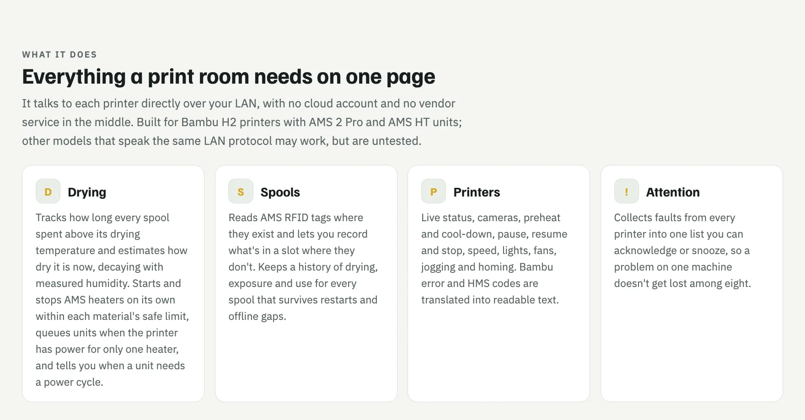
</picture>

## Requirements

<picture>
  <source media="(prefers-color-scheme: dark)" srcset="docs/img/docs-requirements-dark.webp">
  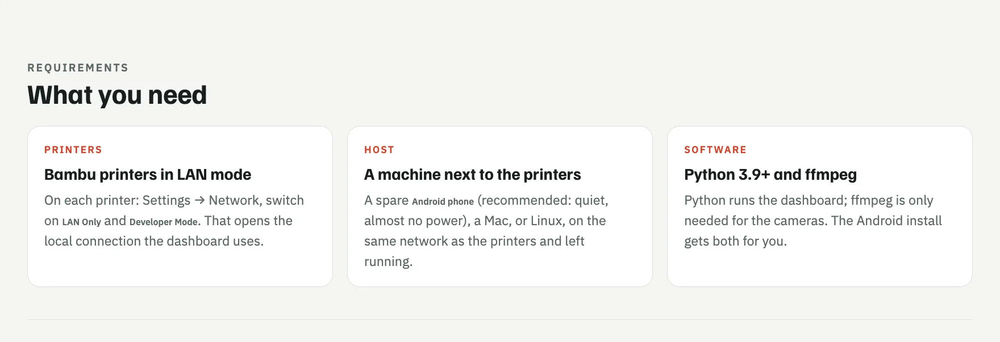
</picture>

## Install on an Android phone

<picture>
  <source media="(prefers-color-scheme: dark)" srcset="docs/img/guide-1-intro-dark.webp">
  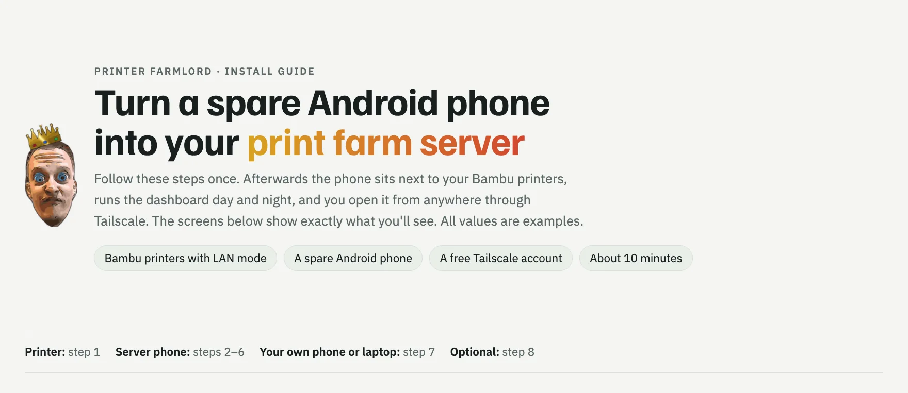
</picture>

<picture>
  <source media="(prefers-color-scheme: dark)" srcset="docs/img/guide-2-steps-1-2-dark.webp">
  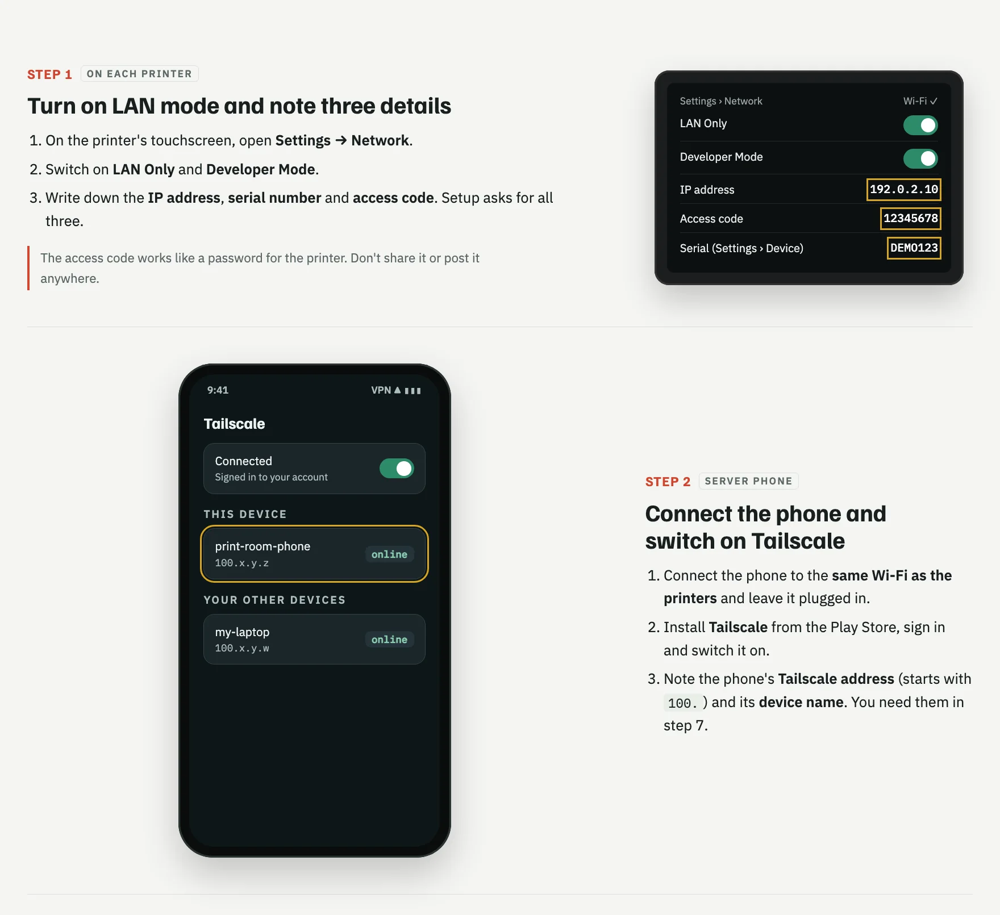
</picture>

<picture>
  <source media="(prefers-color-scheme: dark)" srcset="docs/img/guide-3-steps-3-4-dark.webp">
  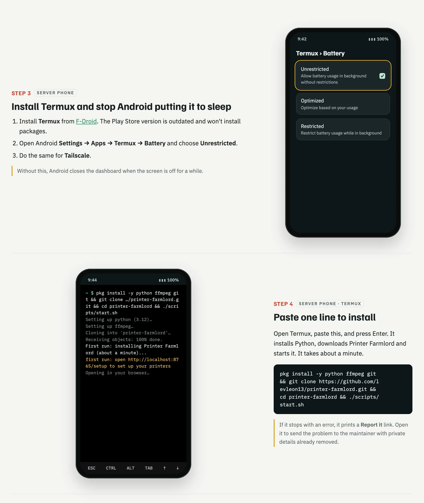
</picture>

<picture>
  <source media="(prefers-color-scheme: dark)" srcset="docs/img/guide-4-steps-5-6-dark.webp">
  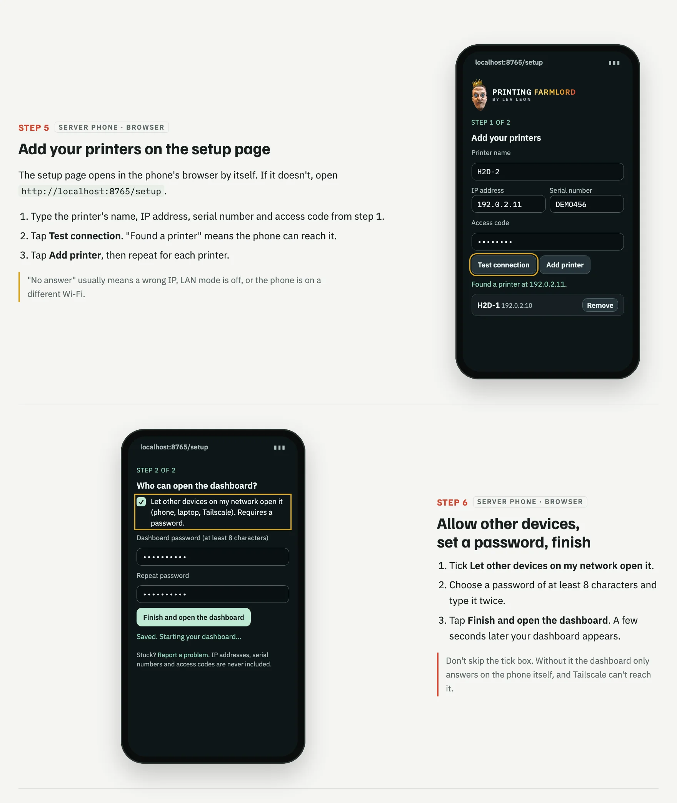
</picture>

<picture>
  <source media="(prefers-color-scheme: dark)" srcset="docs/img/guide-5-steps-7-8-dark.webp">
  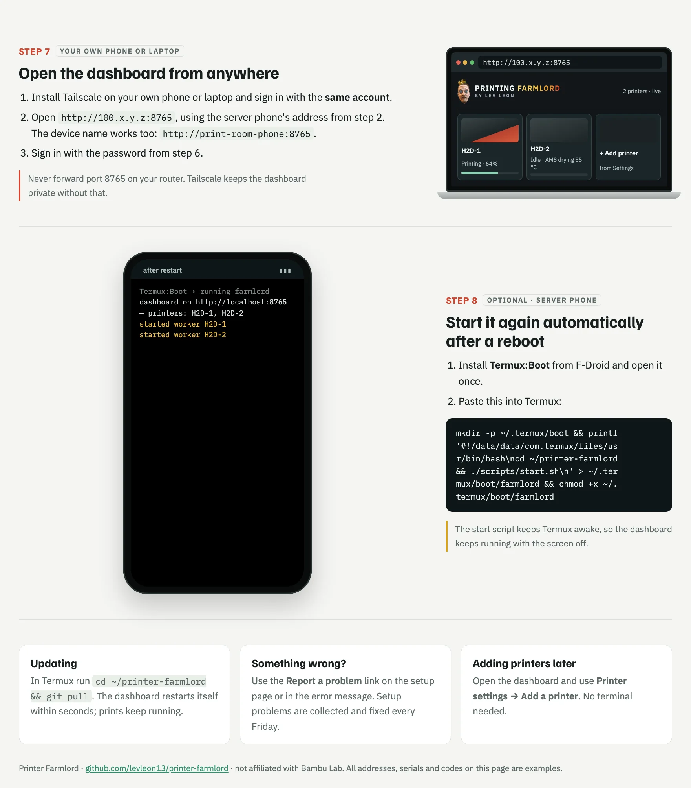
</picture>

**Step 4, paste into Termux:**

```sh
pkg install -y python ffmpeg git && git clone https://github.com/levleon13/printer-farmlord.git && cd printer-farmlord && ./scripts/start.sh
```

**Step 8 (optional), start after a reboot:**

```sh
mkdir -p ~/.termux/boot && printf '#!/data/data/com.termux/files/usr/bin/bash\ncd ~/printer-farmlord && ./scripts/start.sh\n' > ~/.termux/boot/farmlord && chmod +x ~/.termux/boot/farmlord
```

## Install on a Mac or Linux

<picture>
  <source media="(prefers-color-scheme: dark)" srcset="docs/img/docs-mac-linux-dark.webp">
  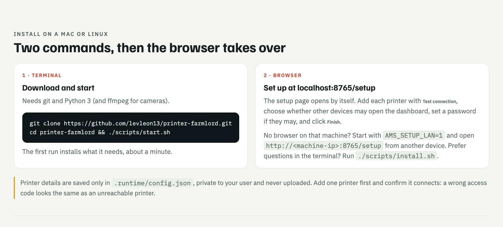
</picture>

```sh
git clone https://github.com/levleon13/printer-farmlord.git
cd printer-farmlord && ./scripts/start.sh
```

## Reaching it from other devices

<picture>
  <source media="(prefers-color-scheme: dark)" srcset="docs/img/docs-remote-dark.webp">
  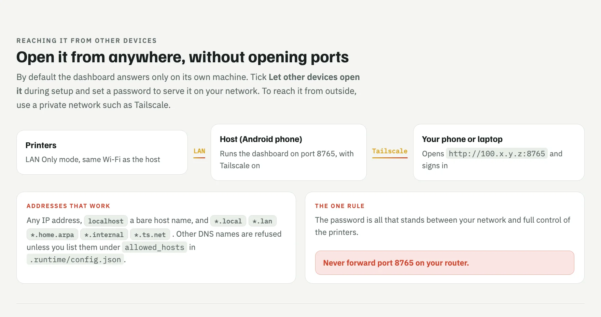
</picture>

## Keeping it running

<picture>
  <source media="(prefers-color-scheme: dark)" srcset="docs/img/docs-running-dark.webp">
  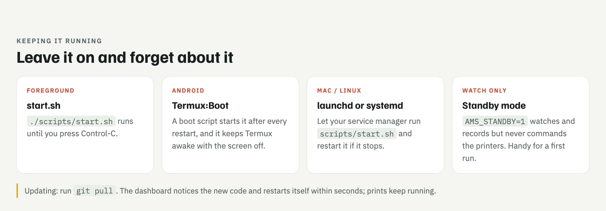
</picture>

## Optional extras

<picture>
  <source media="(prefers-color-scheme: dark)" srcset="docs/img/docs-extras-dark.webp">
  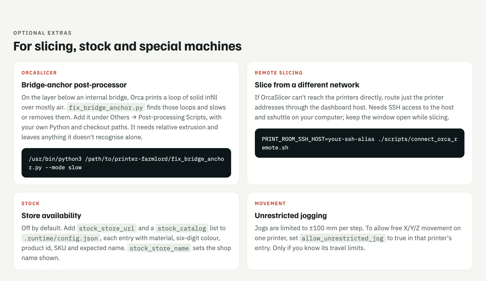
</picture>

```sh
/usr/bin/python3 /path/to/printer-farmlord/fix_bridge_anchor.py --mode slow
```

```sh
PRINT_ROOM_SSH_HOST=your-ssh-alias ./scripts/connect_orca_remote.sh
```

## Security

<picture>
  <source media="(prefers-color-scheme: dark)" srcset="docs/img/docs-security-dark.webp">
  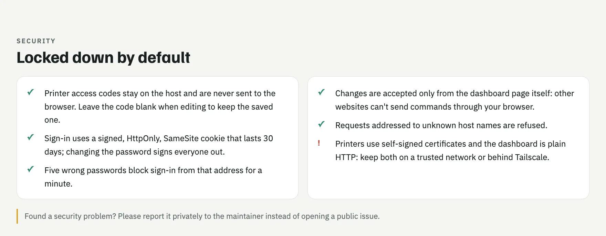
</picture>

## Problems?

<picture>
  <source media="(prefers-color-scheme: dark)" srcset="docs/img/docs-problems-dark.webp">
  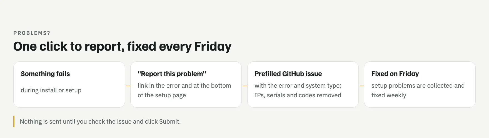
</picture>

[Report a problem](https://github.com/levleon13/printer-farmlord/issues/new?template=problem.yml)

## Privacy and safety

<picture>
  <source media="(prefers-color-scheme: dark)" srcset="docs/img/docs-privacy-safety-dark.webp">
  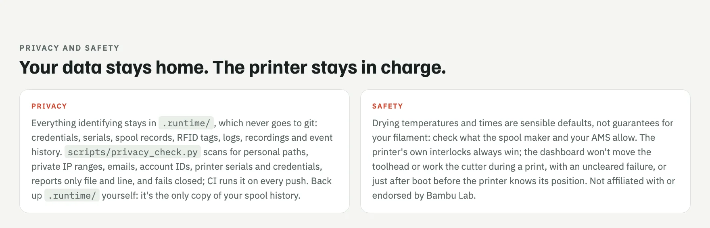
</picture>

## Project layout

<picture>
  <source media="(prefers-color-scheme: dark)" srcset="docs/img/docs-layout-dark.webp">
  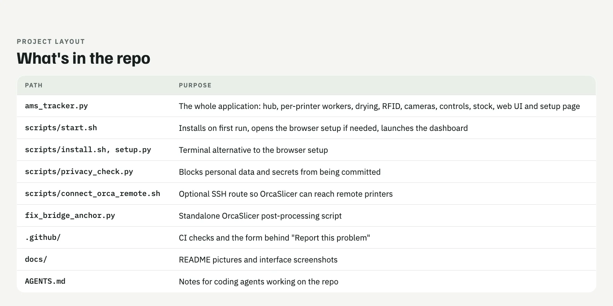
</picture>
