<p align="center">
  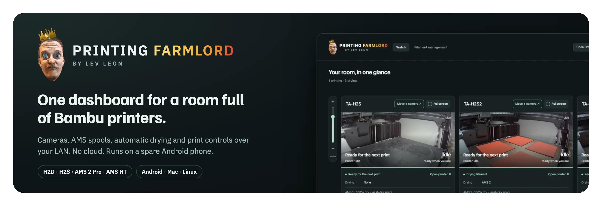
</p>

<p align="center">
  <b><a href="https://levleon13.github.io/printer-farmlord/">Visual install guide</a></b> ·
  <a href="#screenshots">Screenshots</a> ·
  <a href="#install-on-an-android-phone">Install on Android</a> ·
  <a href="#install-on-a-mac-or-linux">Mac or Linux</a> ·
  <a href="https://github.com/levleon13/printer-farmlord/issues/new?template=problem.yml">Report a problem</a>
</p>

# Printer Farmlord

A self-hosted dashboard for a room full of Bambu Lab printers.

It talks to each printer directly over your LAN — no cloud account, no vendor
service in the middle. One page shows every machine: what it is printing, how
hot it is, which spools are loaded, how dry they are, and what needs attention.
From the same page you can start and stop AMS drying, preheat, move the
toolhead, change filament, watch the cameras and track stock.

Built for Bambu H2 series printers with AMS 2 Pro and AMS HT units. Other
models that speak the same LAN protocol may work, but are untested.

## Screenshots

**The room at a glance.** Every printer with its live camera, status and AMS spools.

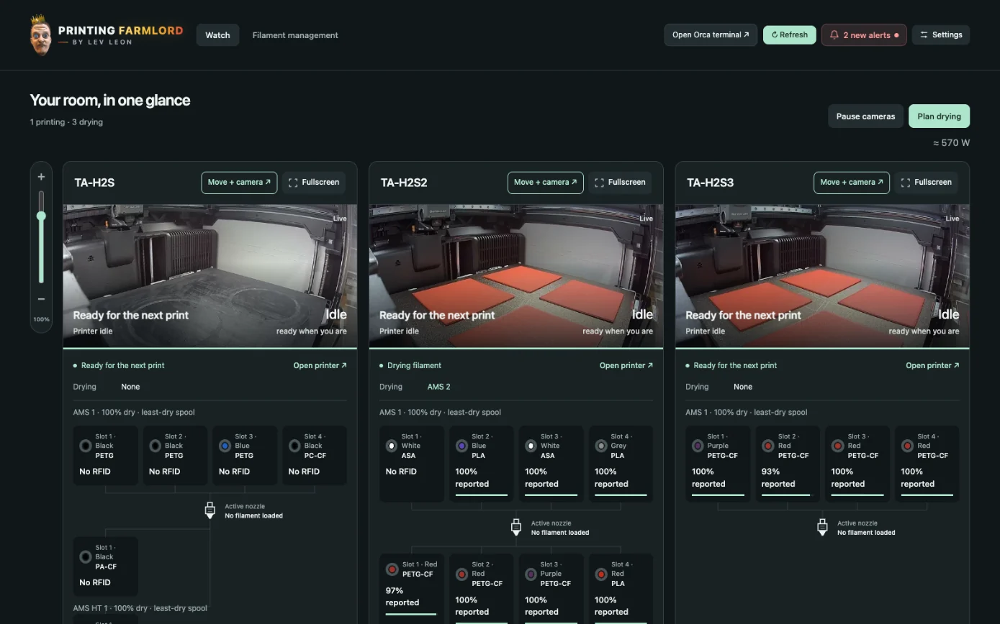

**One printer up close.** Camera, temperatures, filament and drying, quick actions and recent activity.

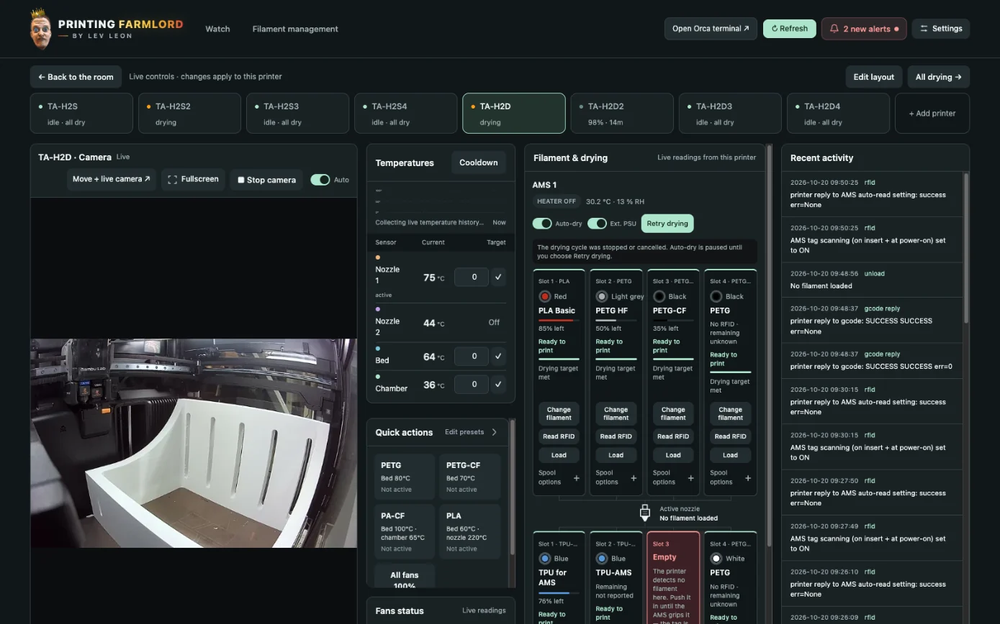

**Filament management.** Spool stock with reorder warnings, and every AMS unit's drying state.

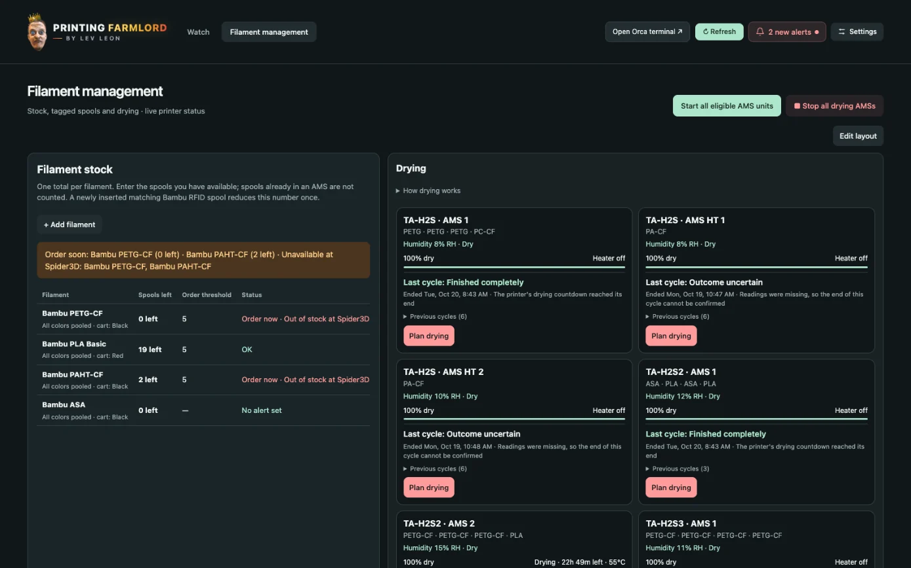

**On a tablet.** The same dashboard adapts to a narrow screen.

<table>
  <tr>
    <td width="50%">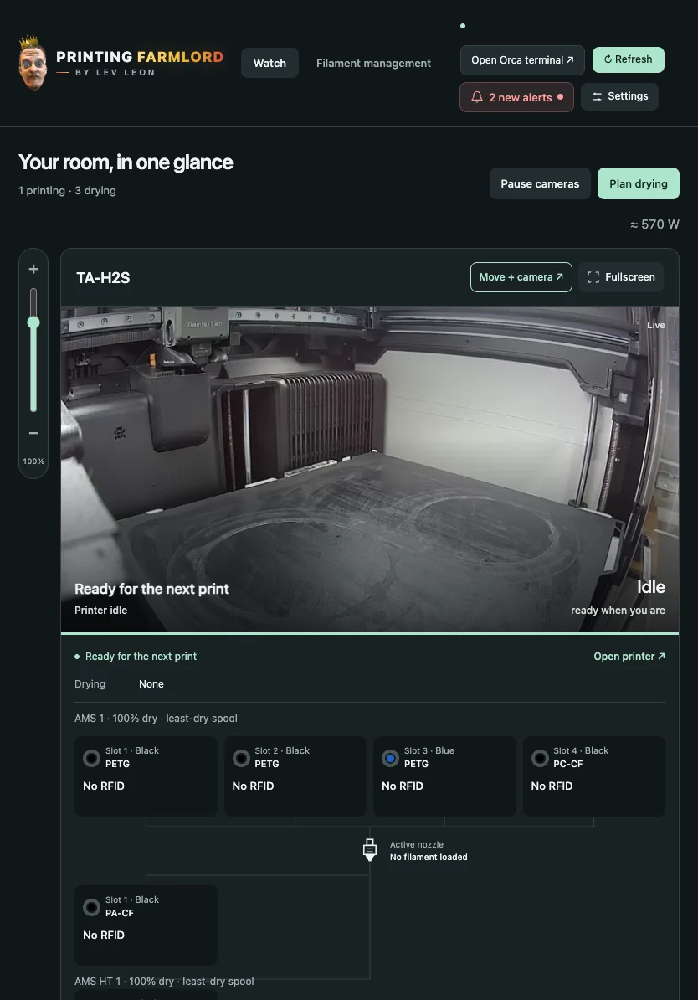</td>
    <td width="50%">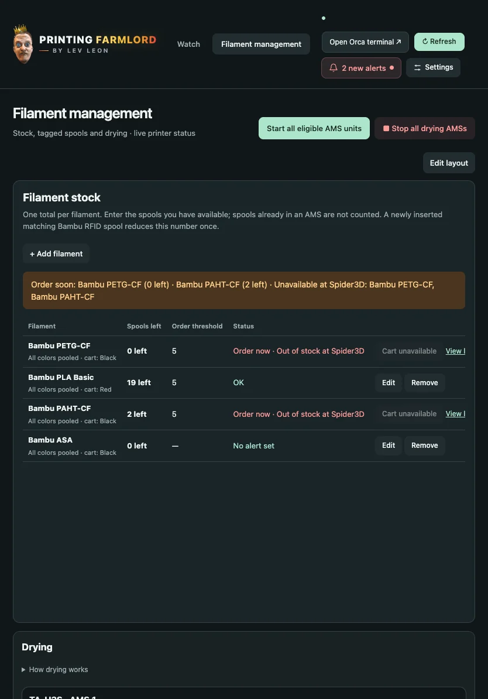</td>
  </tr>
</table>

**Setup in the browser.** No terminal questions: add printers, test each one, set a password.

<table>
  <tr>
    <td align="center">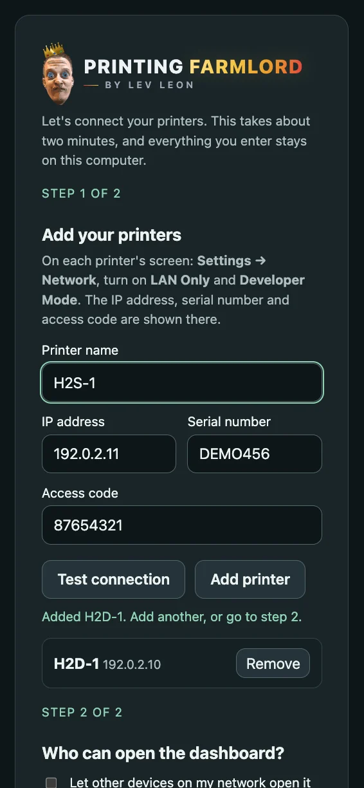</td>
    <td align="center">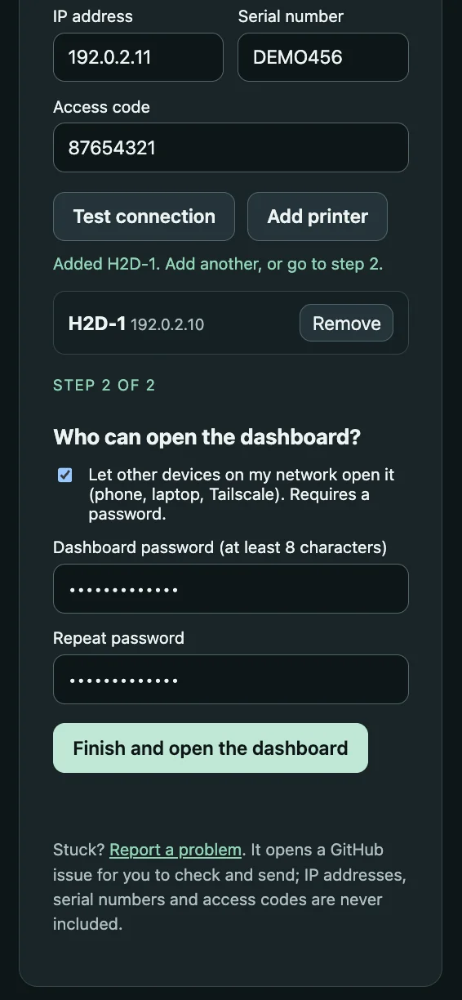</td>
  </tr>
</table>

## What it does

**Drying.** Tracks how long every spool has spent above its drying temperature
and estimates how dry it is now, decaying over time with measured humidity.
Starts and stops AMS heaters on its own, respecting each material's safe
ceiling and the lowest common limit of everything in a unit. It reads the
printer's own refusal reasons rather than guessing, queues units when the
printer only has power for one heater, and tells you when a unit is wedged and
needs a power cycle instead of retrying forever.

**Spools.** Reads AMS RFID tags where they exist and lets you record what is in
a slot where they don't. Keeps a per-spool history of drying, exposure and
consumption that survives restarts and offline gaps.

**Printers.** Live status per machine, cameras, preheat and cool-down, print
pause/resume/stop, speed, lights, fans, manual jogging and homing. Decodes
Bambu's error and HMS codes into readable text.

**Attention.** Collects faults into one list you can acknowledge or snooze, so
a problem on one machine doesn't get lost among four.

## Requirements

- Bambu printers with **LAN Only** and **Developer Mode** turned on
- A host on the same network as the printers: a spare **Android phone** (recommended, uses almost no power), a Mac, or Linux
- Python 3.9 or newer, and `ffmpeg` for the cameras (the Android install below gets both)

## Install on an Android phone

A spare phone left in the print room makes a quiet server, and
[Tailscale](https://tailscale.com) (free for personal use) lets you open the
dashboard from anywhere without opening ports. About 10 minutes, once.
The same steps as a web page: **[visual install guide](https://levleon13.github.io/printer-farmlord/)**.

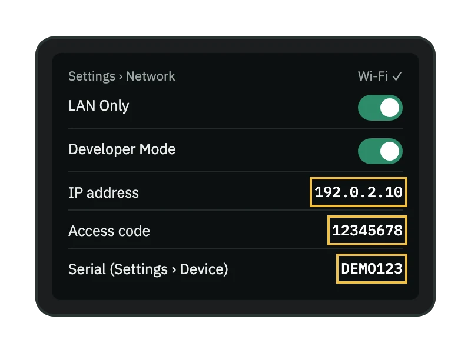

### 1 · On each printer

Open **Settings → Network**, switch on **LAN Only** and **Developer Mode**, and
note the **IP address**, **serial number** and **access code**. Treat the
access code like a password.

<br clear="right">

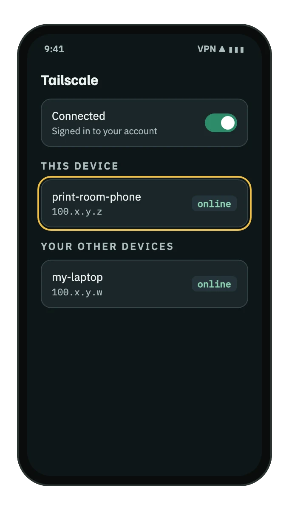

### 2 · Server phone: Wi‑Fi and Tailscale

Connect the phone to the **same Wi‑Fi as the printers** and leave it plugged
in. Install **Tailscale** from the Play Store, sign in and switch it on. Note
the phone's address (`100.x.y.z`) and device name.

<br clear="right">

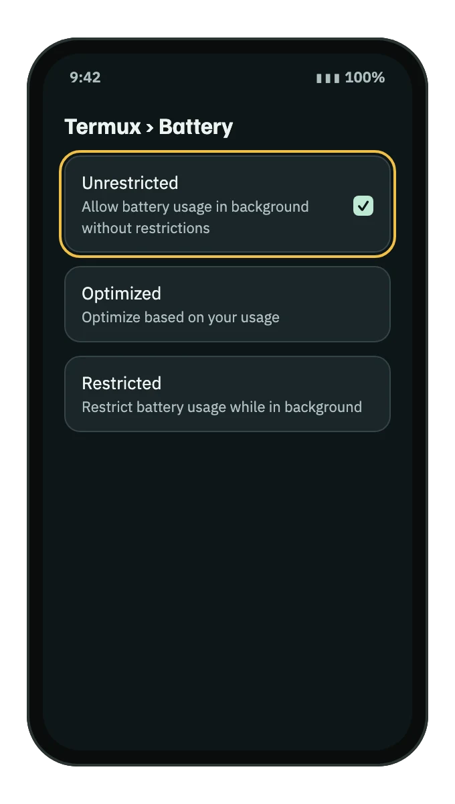

### 3 · Install Termux, keep it awake

Install **Termux** from [F‑Droid](https://f-droid.org/packages/com.termux/)
(the Play Store build is outdated). In **Settings → Apps → Termux → Battery**
choose **Unrestricted**, and do the same for Tailscale.

<br clear="right">

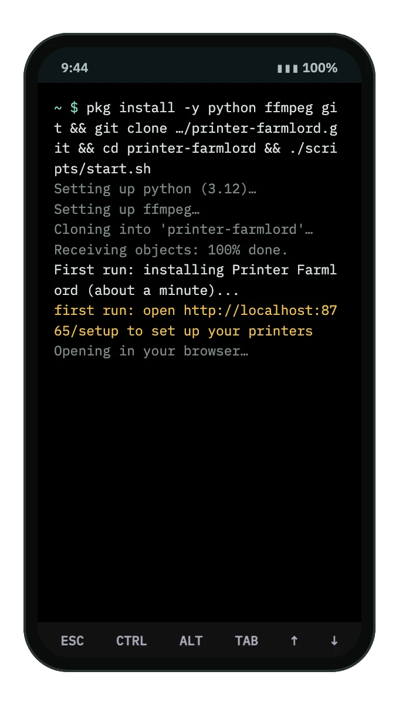

### 4 · Paste one line

Open Termux, paste this and press Enter. It takes about a minute.

```sh
pkg install -y python ffmpeg git && git clone https://github.com/levleon13/printer-farmlord.git && cd printer-farmlord && ./scripts/start.sh
```

If anything fails, the error includes a **Report it** link with private details removed.

<br clear="right">

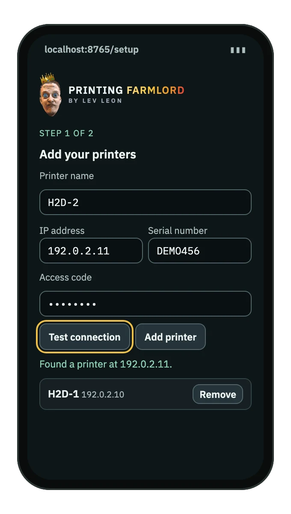

### 5 · Add your printers

The setup page opens in the phone's browser by itself (otherwise open
`http://localhost:8765/setup`). Enter each printer, tap **Test connection**,
then **Add printer**.

<br clear="right">

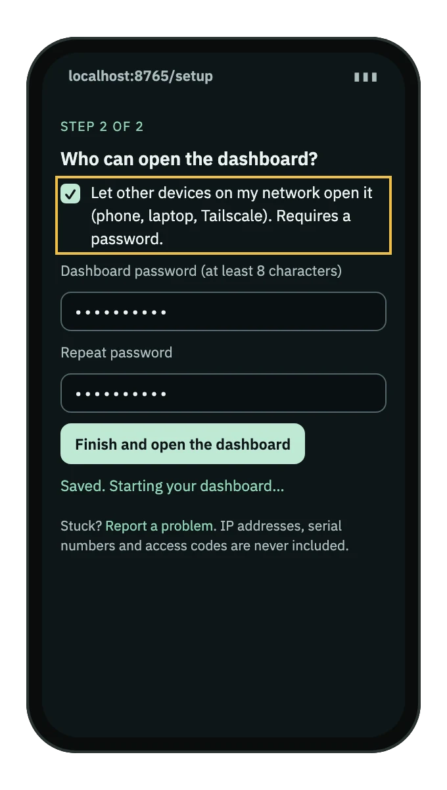

### 6 · Allow other devices, set a password

Tick **Let other devices on my network open it**, choose a password, and tap
**Finish**. Without the tick, the dashboard only answers on the phone itself and
Tailscale can't reach it.

<br clear="right">

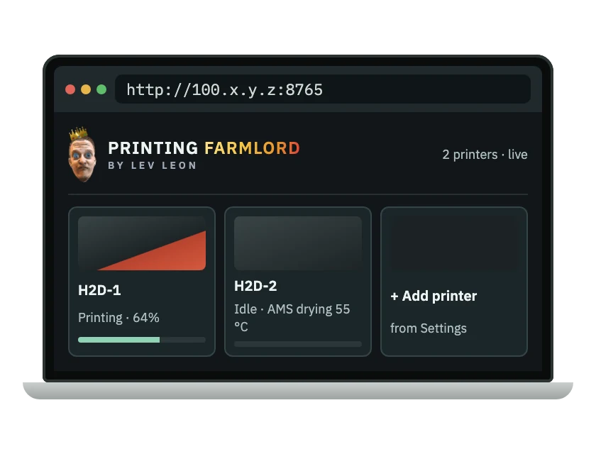

### 7 · Open it from anywhere

On your own phone or laptop, sign in to the same Tailscale account and open
`http://100.x.y.z:8765` (or `http://<device-name>:8765`). **Never forward port
8765 on your router.**

<br clear="right">

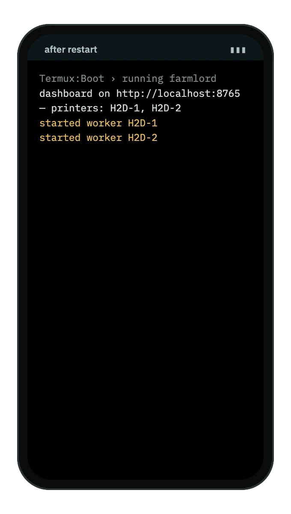

### 8 · Optional: start after a reboot

Install **Termux:Boot**, open it once, then paste:

```sh
mkdir -p ~/.termux/boot && printf '#!/data/data/com.termux/files/usr/bin/bash\ncd ~/printer-farmlord && ./scripts/start.sh\n' > ~/.termux/boot/farmlord && chmod +x ~/.termux/boot/farmlord
```

<br clear="right">

**Setting up from a laptop instead?** Start it with `AMS_SETUP_LAN=1 ./scripts/start.sh`
and open `http://<phone-tailscale-ip>:8765/setup` from a laptop on the same
Tailscale network. The setup page has no password until you finish, so only do
this on a network you trust.

## Install on a Mac or Linux

Needs `git` and Python 3 (and `ffmpeg` for cameras):

```sh
git clone https://github.com/levleon13/printer-farmlord.git
cd printer-farmlord && ./scripts/start.sh
```

The first run installs what it needs and opens the same setup page at
http://localhost:8765/setup. On a machine without a browser, start it with
`AMS_SETUP_LAN=1` and open `http://<machine-ip>:8765/setup` from another device.
Prefer the terminal? `./scripts/install.sh` asks the same questions there.

Your printer details are written only to `.runtime/config.json` (private to your
user, gitignored) and never leave the machine. Add one printer, confirm it
connects, then add the rest: a wrong access code looks the same as an
unreachable printer.

## Reaching it from other devices

By default the dashboard listens on this machine only. Tick **Let other devices
open it** during setup and set a password to serve it on your network, port
8765. The password is the only thing between your network and full control of
the printers, so **do not forward port 8765 to the internet**; use
[Tailscale](https://tailscale.com) or another private network instead.

## Which addresses work

The dashboard only answers requests addressed to an IP address or a local name
(`localhost`, a bare host name, `*.local`, `*.lan`, `*.home.arpa`, `*.internal`,
`*.ts.net`). To use another DNS name, add it to `.runtime/config.json`:
`"allowed_hosts": ["printers.example.org"]`.

## Keeping it running

`./scripts/start.sh` runs in the foreground; Control-C stops it.

For an always-on host, supervise that script with whatever your system uses —
`systemd` on Linux, `launchd` on macOS. On Android, install Termux:Boot and add
a boot script that changes into the checkout and runs `./scripts/start.sh`.

`AMS_STANDBY=1 ./scripts/start.sh` starts in telemetry-only mode: it watches and
records, but will not command the printers. Useful for a first run, or for a
second instance that should only observe.

## Optional: the bridge-anchor post-processor

`fix_bridge_anchor.py` is a standalone OrcaSlicer post-processing script,
independent of the dashboard.

On the layer below an internal bridge, Orca emits a closed loop of solid infill
that hugs the walls and prints at full speed over mostly air. This script finds
those loops and either slows them down or removes them.

To use it, open OrcaSlicer, go to **Others → Post-processing Scripts** and add:

```
/usr/bin/python3 /path/to/printer-farmlord/fix_bridge_anchor.py --mode slow
```

Use the full path to your own Python and your own checkout. `--mode slow`
retimes the loops and sets a fan override; `--mode delete` removes them
entirely.

It requires **relative extrusion**, which is Orca's default for Bambu printers,
and aborts untouched if it finds absolute extrusion. Detection is
shape-independent and deliberately conservative: anything it does not
positively recognise is left alone. Arc fitting (G2/G3) is handled.

Slice something familiar and compare the preview before trusting it on a long
print.

## Optional: slicing from a different network

If OrcaSlicer runs somewhere that cannot reach the printers directly, you can
route just the printer addresses through the dashboard host:

```
PRINT_ROOM_SSH_HOST=your-ssh-alias ./scripts/connect_orca_remote.sh
```

This needs SSH access to that host, `sshuttle` installed locally, and the
checkout at `~/printer-farmlord` on the far end. It reads the printer IPs from
the remote config. Keep the terminal open while you are slicing. On Termux, set
`PRINT_ROOM_SSHUTTLE_PYTHON` to the Termux Python path.

## Optional: stock tracking

Off by default. To enable it, add `stock_store_url` and a `stock_catalog` array
to `.runtime/config.json`. Each entry needs `material`, a six-digit `color`,
a numeric `product_id`, `sku` and `expected_name`. Optionally set
`stock_store_name` to show the shop's name instead of "configured store".
Restart afterwards.

## Optional: unrestricted jogging

The movement page limits jogs to ±100 mm per step. To allow free X/Y/Z
movement on one printer, add `"allow_unrestricted_jog": true` to that printer's
entry in `.runtime/config.json` and restart. Only do this if you know the
machine's travel limits.

## Security

- Printer access codes stay on the host and are never sent to the browser. In
  the edit form, leave the code blank to keep the saved one.
- Sign-in uses a signed, HttpOnly, SameSite cookie that lasts 30 days; changing
  the password signs everyone out. Five wrong passwords block sign-in from that
  address for a minute.
- Changes are only accepted from the dashboard page itself: other websites
  cannot send commands through your browser, and requests addressed to unknown
  host names are refused.
- The printers use self-signed TLS certificates that cannot be verified, and the
  dashboard itself is plain HTTP. Keep both on a network you trust, or reach the
  dashboard through Tailscale/WireGuard.

Found a security problem? Please report it privately to the maintainer rather
than in a public issue.

## Problems?

If installing or setup fails, the error message includes a **Report this
problem** link (the setup page also has one at the bottom). It opens a GitHub
issue already filled in with the error and your system type; IP addresses,
serial numbers and access codes are removed first, and nothing is sent until you
click Submit. Setup problems are collected and fixed every Friday.

## Privacy

Everything identifying stays in `.runtime/`, which is gitignored: credentials,
serials, spool records, RFID tags, logs, recordings and event history.

`scripts/privacy_check.py` scans for personal paths, private and CGNAT IP
ranges, emails, account UUIDs, printer serials and credential assignments. It
reports file and line numbers without echoing what it found, and fails closed.
Run it before every push:

```
python3 scripts/privacy_check.py
```

CI repeats that check, plus a syntax check, on every push and pull request.

If you fork this, back up `.runtime/` separately. It is the only copy of your
spool history.

## Safety

Drying temperatures and durations in this project are sensible defaults, not
guarantees for your filament. Confirm what your spool's manufacturer allows,
and what your AMS model supports with and without external power.

The printer's own interlocks always take precedence — this dashboard does not
and cannot bypass them. It will refuse to move the toolhead or operate the
filament cutter while a print is running, while the printer reports an
uncleared failure, or in the minutes after the printer boots and has not yet
established a position reference.

Nothing here is affiliated with or endorsed by Bambu Lab.

## Layout

| Path | Purpose |
| --- | --- |
| `ams_tracker.py` | The whole application: hub, per-printer MQTT workers, drying, RFID, cameras, controls, inventory, web UI |
| `fix_bridge_anchor.py` | Standalone Orca post-processing script |
| `scripts/start.sh` | Installs on first run, opens browser setup if needed, launches the dashboard |
| `scripts/install.sh` | Terminal alternative: creates the virtualenv and runs setup |
| `scripts/setup.py` | Terminal prompts for printer credentials, writes `.runtime/config.json` |
| `scripts/privacy_check.py` | Pre-commit scan for identifying data |
| `scripts/connect_orca_remote.sh` | Optional SSH route to the printer LAN |
| `.github/workflows/verify.yml` | CI: privacy and syntax checks |
| `.github/ISSUE_TEMPLATE/problem.yml` | Form behind the "Report this problem" links |
| `docs/index.html` | The visual install guide, served by GitHub Pages |
| `docs/img/`, `docs/screenshots/` | README banner, install-step pictures and interface screenshots |
| `AGENTS.md` | Orientation for a coding agent working on this repo |
